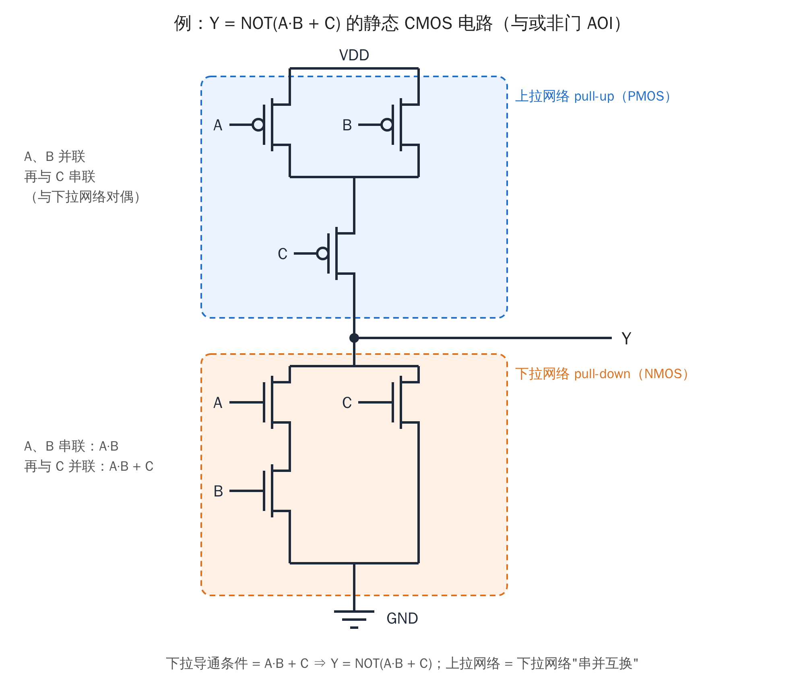
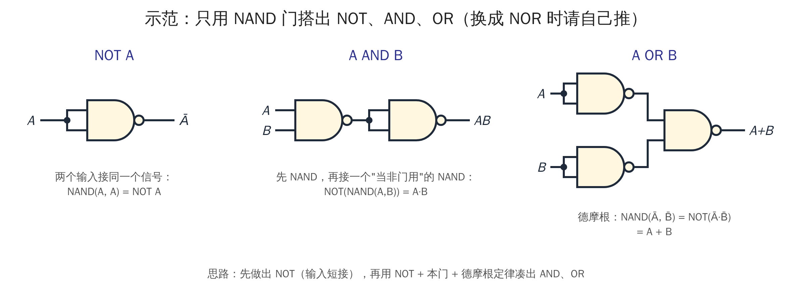
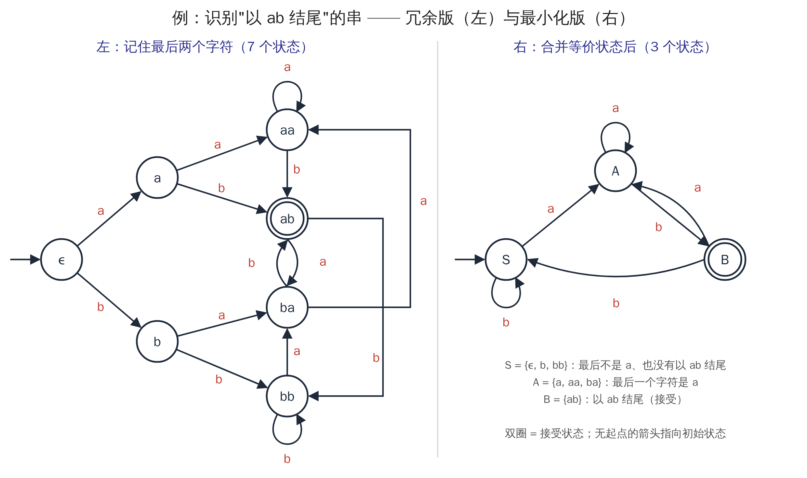
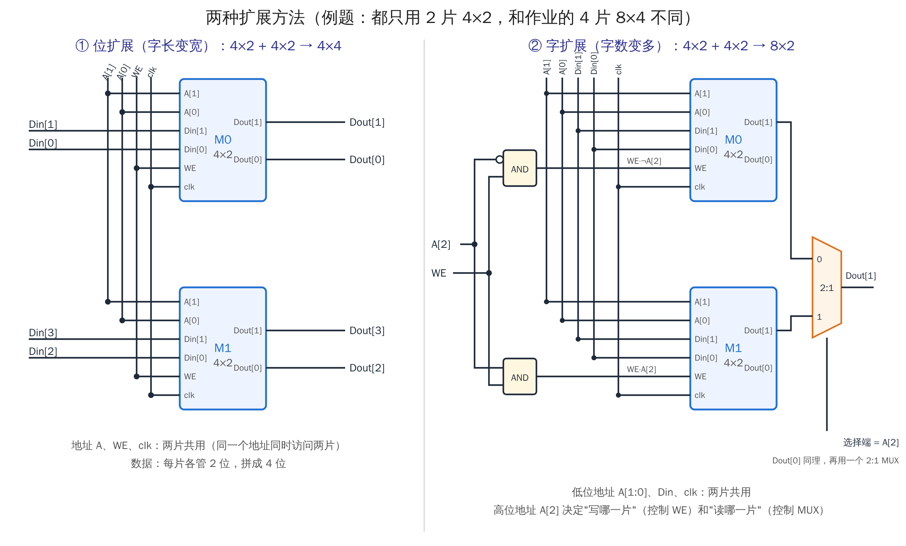

# HW2 前置知识讲义（Prerequisites for HW2）

> **怎么用这份讲义**
> - 每节对应 HW2 的一道大题，结构固定为：**① 要学的知识 → ② 例题 → ③ 做题检查清单**。
> - 例题**故意换了别的电路/数字/语言**，不是 HW2 的答案。学会方法后，HW2 要你自己做。
> - 每节末尾有 1 道小练习，答案在文末【练习答案】。先自己做，再对答案。
> - 英文术语第一次出现时附中文；作业本身是英文，所以术语要认得。

---

## 0. 术语中英对照（Glossary）

| English | 中文 | English | 中文 |
|---|---|---|---|
| transistor | 晶体管 | static CMOS | 静态 CMOS |
| NMOS / PMOS | N 型 / P 型 MOS 管 | pull-up / pull-down network | 上拉 / 下拉网络 |
| series / parallel | 串联 / 并联 | dual | 对偶 |
| functionally complete | 功能完备 | half adder | 半加器 |
| carry / sum | 进位 / 和 | constant input | 常数输入 |
| deterministic finite automaton (DFA) | 确定有限自动机 | state / transition | 状态 / 转移 |
| initial / accepting state | 初始 / 接受状态 | suffix | 后缀 |
| equivalent states | 等价状态 | minimize | 最小化 |
| von Neumann architecture | 冯·诺依曼结构 | Harvard architecture | 哈佛结构 |
| instruction cycle | 指令周期 | phase | 阶段 |
| effective address | 有效地址 | omitted | 省略 |
| flip-flop (DFF) | （D）触发器 | rising edge | 上升沿 |
| decoder | 译码器 | multiplexer (MUX) | 多路选择器 |
| synchronous / asynchronous | 同步 / 异步 | word | 字（存储器的一行） |

---

## T1 · Static CMOS（静态 CMOS 电路）

### ① 要学的知识

**1. 晶体管就是一个"受控开关"。**

| 类型 | 符号特点 | 栅极 = 1 | 栅极 = 0 | 放在哪里 |
|---|---|---|---|---|
| **NMOS** | 栅极**没有**小圆圈 | 导通（开关闭合） | 断开 | 下面：接 GND（下拉） |
| **PMOS** | 栅极**有**小圆圈 | 断开 | 导通 | 上面：接 VDD（上拉） |

记法：PMOS 的小圆圈 = "取反"，所以它在输入为 **0** 时导通。

**2. 串联 = 与，并联 = 或（说的是"什么时候导通"）。**

- 两个 NMOS（栅极 A、B）**串联**：A **且** B 都为 1 才通 → 导通条件 A·B
- 两个 NMOS **并联**：A **或** B 为 1 就通 → 导通条件 A + B
- PMOS 一样，只是每个输入要取反：PMOS 串联导通条件是 Ā·B̄，并联是 Ā + B̄

**3. 静态 CMOS 的规则。**

```
VDD
 │
[上拉网络 PUN：全是 PMOS]
 │
 ├──── Y
 │
[下拉网络 PDN：全是 NMOS]
 │
GND
```

- 对**任何**一组输入，**上拉和下拉恰好一个导通**：
  - 上拉通 → Y 接到 VDD → **Y = 1**
  - 下拉通 → Y 接到 GND → **Y = 0**
  - 两个都通会短路，两个都不通 Y 就悬空：这两种情况都不允许。
- 所以：**Y = NOT（下拉网络的导通条件）**
- 要做到"恰好一个导通"，上拉和下拉必须是**对偶**（dual）的：
  > **下拉里串联的地方，上拉里就并联；下拉里并联的地方，上拉里就串联。**（输入变量一一对应，管子类型 NMOS↔PMOS。）

**4. 标准例子：**

| 门 | 下拉网络（NMOS） | 上拉网络（PMOS） | Y |
|---|---|---|---|
| NOT | 1 个 NMOS（A） | 1 个 PMOS（A） | Ā |
| NAND | A、B **串联** | A、B **并联** | NOT(A·B) |
| NOR | A、B **并联** | A、B **串联** | NOT(A+B) |

### ② 例题：Y = NOT(A·B + C)（与或非门，AOI）



步骤：
1. 括号里 A·B + C 就是**下拉导通条件**：A·B 用 A、B **串联**，"+ C" 就是再**并联**一个 C。
2. 上拉做**对偶**：A、B 改成**并联**，再和 C **串联**；全部换成 PMOS。
3. 检查一组输入，比如 A=1、B=0、C=0：下拉中 A·B=0、C=0，不通；上拉中 B 的 PMOS 通（B=0），C 的 PMOS 通（C=0），所以上拉通，Y = 1 = NOT(0 + 0) ✓

**反过来用（HW2 T1 就是这种）：** 如果题目给了上拉网络，让你补下拉网络：
1. 先读出上拉的结构（谁和谁串联、谁和谁并联）；
2. 下拉 = 把结构**串并互换**，PMOS 换成 NMOS；
3. 写出下拉的导通条件，Y = NOT(这个条件)。

### ③ 做题检查清单

- [ ] 上拉部分哪些管子串联、哪些并联？可以用括号写出结构，比如"A ∥ (B 串 C)"。
- [ ] 你的下拉是不是**严格对偶**？已有的那个 NMOS(A) 与虚线框是什么连接关系（注意中间节点 X）？
- [ ] 虚线框里只放 2 个 NMOS，栅极分别是 B、C。
- [ ] 把 ABC 的 8 种组合列一张表，检查**每一行都恰好有一个网络导通**。
- [ ] 最后写出 Y 的表达式。可以再化简或用德摩根变形，和上拉的导通条件对照一下。

### 小练习 T1

上拉网络是：PMOS(A) **串联**（PMOS(B) 并联 PMOS(C)）。请画出下拉网络，并写出 Y。

---

## T2 · Functional completeness & Half adder（功能完备性与半加器）

### ① 要学的知识

**1. 什么是功能完备（functionally complete）？**
一组门**功能完备**，是指：只用这组门（数量不限），可以实现**任何**真值表。

**2. 怎么证明"完备"？**
我们早就知道 {AND, OR, NOT} 是完备的：任何真值表都能写成积之和（第 2 课的方法）。所以：

> 只要能用这组门搭出 **NOT** 和 **AND**（或者 NOT 和 OR），这组门就完备。
> 有 NOT 和 AND 以后，OR 可以用德摩根定律得到：A + B = NOT(NOT A · NOT B)。

**3. 怎么证明"不完备"？——找"不变的性质"（invariant）**

> 找一个性质 P，满足：
> ① 这组里**每个门**都满足 P；
> ② 把满足 P 的电路接在一起，结果**仍然**满足 P；
> ③ 但 NOT 或 AND 这个基本函数**不满足** P。
> 那么这组门永远搭不出 NOT 或 AND，所以不完备。

**例：{AND, OR} 不完备。**
- 性质 P = "**单调**"（monotone）：把某个输入从 0 改成 1，输出**不会从 1 变成 0**。
- AND、OR 都是单调的；单调的门串起来仍然单调（①②成立）。
- 但 NOT 不单调：输入 0→1 时，输出 1→0（③成立）。
- 所以 {AND, OR} 搭不出 NOT，不完备。

> 做 HW2 Set I（XOR + NOT）时，你要自己判断它到底完备不完备。如果觉得不完备，就找一个 XOR 和 NOT 都满足、但 AND 不满足的性质。提示：试试**只翻转一个输入**，看输出会怎么变；也可以数一数真值表里有几个 1。

**4. 两条规则（HW2 写在 Note 里）：**
- 同一个信号可以同时接到一个门的**两个输入**（这是做出 NOT 的关键技巧）；
- **不能用外部常数**：不能把 0 或 1 直接接到输入上。所以像 "XOR(A, 1) = NOT A" 这种做法是不允许的。

### ② 例题 A：只用 NAND 搭 NOT、AND、OR



- NOT A = NAND(A, A)
- A·B = NOT(NAND(A, B))
- A + B = NAND(NOT A, NOT B)（德摩根）

> HW2 要求的是 **NOR**。NOR 和 NAND 是对称的：把上面的思路用德摩根定律"翻一下"就能得到，请自己推。

### ② 例题 B：从"整数关系"推出逻辑表达式（方法示范）

HW2 给的是 A + B = 2·C_out + S。这里换一个例子：**设计"相等检测器"**，输入 A、B（各 1 位），A = B 时输出 E = 1。

1. **列真值表**：把所有输入组合都列出来。

   | A | B | E |
   |:-:|:-:|:-:|
   | 0 | 0 | 1 |
   | 0 | 1 | 0 |
   | 1 | 0 | 0 |
   | 1 | 1 | 1 |

2. **写积之和**：E = Ā·B̄ + A·B。
3. **认出常见函数**：这其实是 XOR 取反，也就是 XNOR。
4. **换成指定的门**：把每个 NOT、AND、OR 换成例题 A 里对应的搭法。（只用 NAND 实现时，E = NAND(NAND(Ā, B̄), NAND(A, B))。）

**做半加器时的小提示：** 先对 A、B 的 4 种组合算出 A + B 的整数值（0、1 或 2），再把它写成 **2·C_out + S** 的形式，就能读出每一行的 C_out 和 S。

### ③ 做题检查清单

- [ ] 两组门各自判断：完备的一组给出 NOT、AND、OR 的电路；不完备的一组给出**理由**（不变性质）。
- [ ] 电路里没有用常数 0 或 1。
- [ ] 半加器的真值表 4 行都算对了，S 和 C_out 的表达式都有推导过程。
- [ ] 最终电路里**每个门都属于你选的那组**（AND、OR、XOR 都要换成那组门的搭法）。

### 小练习 T2

只用 NAND 门实现 F = A·B̄（A 且非 B）。最少要几个 NAND？

---

## T3 · DFA（确定有限自动机）

### ① 要学的知识

**1. 组成：**
- **状态**（圆圈）；
- **初始状态**：有一个"没有起点的箭头"指向它；
- **接受状态**：双圈；
- **转移**：从每个状态出发，对字母表里的**每个**字符都**恰好有一条**箭头（这叫"确定的"，deterministic）。

**2. 怎么判断一个串接不接受：**
从初始状态开始，**一个字符一个字符地**沿箭头走。读完整个串后：
- 停在接受状态 → 接受（accept）
- 停在其他状态 → 拒绝（reject）

**空串**（ε，一个字符都没有）：不移动，就停在初始状态，看初始状态是不是接受状态。

写"状态序列"时，**要把初始状态也写上**。读 n 个字符，就有 n + 1 个状态。

**3. "记住后缀"型自动机：**
很多 DFA 的状态名就是"**最近读到的几个字符**"。比如状态 ba 表示"最后两个字符是 b、a"。这样的 DFA 判断的通常是"**串是否以某个模式结尾**"。

**4. 最小化（minimization）：合并等价状态**

> 两个状态**等价**：从这两个状态出发，**不管后面再读什么串**，结果（接受或拒绝）都一样。等价的状态可以合并成一个。

**分组细化法**（每一步都把组分得更细）：
1. 先分两组：{接受状态}、{非接受状态}。
2. 对每一组里的每个状态，看它读 a、读 b 分别到达**哪一组**。到达的组不完全相同的状态，就拆开。
3. 重复第 2 步，直到不再有组需要拆开。最后每一组合并成一个新状态。

### ② 例题：识别"以 ab 结尾"的串



**(a) 追踪示范**（用左边的 7 状态 DFA）：
- 串 `bab`：ε → b → ba → ab，停在 ab，接受 ✓
- 串 `aba`：ε → a → ab → ba，停在 ba，拒绝 ✗

**(b) 一句话描述：** "All strings over {a, b} that end with ab."（以 ab 结尾的所有串。）
描述要**精确**：说清楚"结尾"还是"包含"，长度不够的串（比如空串、a）算不算。

**(c) 最小化过程：**

| 轮次 | 分组 | 说明 |
|---|---|---|
| P0 | {ab} │ {ε, a, b, aa, ba, bb} | 接受 / 非接受 |
| 看第二组 | a 读 b → ab（第一组）；aa 读 b → ab；ba 读 b → ab；而 ε、b、bb 读 b 都留在第二组 | 拆开 |
| P1 | {ab} │ {a, aa, ba} │ {ε, b, bb} | |
| 再检查 | {a, aa, ba}：读 a 都到 aa（同组），读 b 都到 ab；{ε, b, bb}：读 a 都到 {a, aa, ba} 这组，读 b 都留在本组 | 不再拆 → 结束 |

结果是 3 个状态（右图）：S = {ε, b, bb}、A = {a, aa, ba}、B = {ab}。新的初始状态 = **包含原初始状态 ε 的那一组**，新的接受状态 = 包含原接受状态的组。

> 直观理解：要判断"以 ab 结尾"，只需记住"**最后一个字符是不是 a**"以及"**是不是刚好以 ab 结尾**"。

### ③ 做题检查清单

- [ ] 先把 HW2 图 3 的 **14 条转移**整理成一张表（7 个状态 × 2 个字符），之后追踪和最小化都靠这张表。
- [ ] 状态序列从 ε 开始写，最后说明接受还是拒绝。
- [ ] 一句话描述：哪个后缀？长度不够的串算不算？
- [ ] 用分组细化法逐轮写出分组。
- [ ] 新图的每个状态都有 a、b 两条出边；标出初始状态和接受状态。

### 小练习 T3

用右边的 3 状态 DFA 追踪串 `abba` 和 `aab`，写出状态序列，并判断接受还是拒绝。

---

## T4 · 冯·诺依曼结构 & 哈佛结构

### ① 要学的知识

**1. 冯·诺依曼结构的五大部件（教材第 4 章）：**

| 部件 | English | 作用 |
|---|---|---|
| 存储器 | Memory | 存放**程序（指令）和数据** |
| 处理单元 | Processing Unit（ALU + 临时寄存器） | 做运算 |
| 控制单元 | Control Unit（含 PC、IR） | 取指令、译码，控制其他部件按步骤工作 |
| 输入 | Input | 键盘、鼠标、磁盘读入…… |
| 输出 | Output | 显示器、打印机…… |

- **CPU = 处理单元 + 控制单元**。
- 填图 4 时想清楚三件事：哪两个部件在 CPU 内部？谁指挥谁（箭头方向）？哪个部件和 CPU 之间是**双向**箭头（又读又写）？

**2. 存储程序（stored program）：** 冯·诺依曼结构的核心是"**指令和数据存放在同一个存储器里**，经同一条通路访问"。
- 好处：结构简单，程序也可以当作数据来处理。
- 坏处：取指令和读写数据要争用同一条通路，这叫"**冯·诺依曼瓶颈**"。

**3. 哈佛结构（Harvard architecture）：**
- **指令存储器**和**数据存储器**分开，各有独立的通路（总线）。
- 所以可以**同时**取下一条指令和读写数据，速度更快。
- 代价是硬件更复杂，两块存储器的容量分配也不灵活。

**4. 现代计算机怎么用（理解这几点，自己组织语言）：**
- CPU 内部最靠近核心的一级缓存通常**分成** L1 指令 cache（I-cache）和 L1 数据 cache（D-cache），这一层像哪种结构？
- 再往外的 L2/L3 cache 和主存（内存条）通常是**统一**存放指令和数据的，这一层又像哪种结构？
- 很多单片机、DSP 把程序放在 Flash 里，数据放在 SRAM 里，这像哪种结构？
- 这种混合做法常被叫作"**改进型哈佛结构**"（modified Harvard architecture）。这正是题目提示"不必把整台机器硬塞进一种纯粹结构"的意思。

### ③ 做题检查清单

- [ ] 图 4 的 I–V 每个框都填了名字，并且符合箭头方向。
- [ ] 第 2 问写了三点：哈佛结构的定义；与冯·诺依曼结构的区别（存储器和通路分开或共用，各自的优缺点）；现代计算机里两者怎么结合。
- [ ] 字数不超过 200 个汉字或 200 个英文单词。

---

## T5 · LC-3 指令周期

### ① 要学的知识

**1. 四个关键寄存器（见教材 Figure C.3 数据通路）：**
- **PC**（Program Counter）：存放**下一条要取的指令**的地址；取完指令后加 1。
- **IR**（Instruction Register）：存放**当前正在执行的指令**本身。
- **MAR**（Memory Address Register）：要访问内存时，先把**地址**放进这里。
- **MDR**（Memory Data Register）：从内存读出的数据、或准备写进内存的数据，都经过这里。

> 读内存的标准动作：地址 → MAR，内存把那个地址的内容 → MDR。
> 写内存：地址 → MAR，数据 → MDR，然后发出写信号。

**2. 指令周期的六个阶段（教材第 4 章）：**

| # | 阶段 | 做什么 |
|---|---|---|
| 1 | **FETCH**（取指） | MAR ← PC，PC ← PC + 1，从内存读出指令，IR ← MDR |
| 2 | **DECODE**（译码） | 看 IR 的操作码（[15:12]），判断这是哪种指令、要用哪些部件 |
| 3 | **EVALUATE ADDRESS**（计算地址） | 需要访问内存的指令在这里算出**有效地址** |
| 4 | **FETCH OPERANDS**（取操作数） | 取出运算需要的数据：从寄存器读，或者从内存读 |
| 5 | **EXECUTE**（执行） | 真正做运算，比如 ALU 加法、按位与、取反 |
| 6 | **STORE RESULT**（存结果） | 把结果写回目的地：寄存器或内存 |

> **不是每条指令都要用到所有阶段**。用不到的阶段就是"**省略**"（omitted）。

**3. 例题：用六个阶段分析两条 LC-3 指令**（都不是 HW2 里的指令）

**LDR R1, R2, #3**（把内存地址 R2+3 处的值读进 R1）：

| 阶段 | 做什么 |
|---|---|
| FETCH | 取出这条指令到 IR，PC 加 1 |
| DECODE | 识别出是 LDR |
| EVALUATE ADDRESS | 地址 = R2 + SEXT(#3) |
| FETCH OPERANDS | 用这个地址读内存：MAR ← 地址，MDR ← 内存内容 |
| EXECUTE | **省略**（不需要运算） |
| STORE RESULT | R1 ← MDR，并设置条件码 N、Z、P |

**NOT R4, R5**（R4 ← R5 按位取反）：

| 阶段 | 做什么 |
|---|---|
| FETCH | 取指令，PC 加 1 |
| DECODE | 识别出是 NOT |
| EVALUATE ADDRESS | **省略**（不访问内存） |
| FETCH OPERANDS | 读寄存器 R5 |
| EXECUTE | ALU 做按位取反 |
| STORE RESULT | 结果写入 R4，设置条件码 |

> 分析 HW2 里的指令 B 时要注意：它**既读内存、又写内存**。想一想"读那个字"属于哪个阶段，"写回同一个地址"又属于哪个阶段。

**4. "阶段"不等于"时钟周期"：**
- 阶段是**概念上**的步骤，说的是"要做哪几件事"；时钟周期是硬件实际花的**时间单位**。
- 一个阶段可能要**好几个**时钟周期。比如 LC-3 的 FETCH 在状态机里就占了好几个状态，访问内存还可能需要等待。
- 有的阶段会被**省略**，不花时间。
- 不同指令用到的阶段不同，花的周期数也不同。
- 用这几点去评价 T5-4 那句话。

### ③ 做题检查清单

- [ ] 4 个寄存器一一配对。
- [ ] 6 个阶段**按顺序**写，每个阶段配一句作用。
- [ ] 指令 A、B 都写满 6 个阶段，每个阶段写出做什么，或标"omitted"。
- [ ] 第 4 问先判断对错，再给理由。

### 小练习 T5

用六个阶段分析 **STR R3, R6, #-2**（把 R3 的值写到内存地址 R6 − 2 处）。

---

## T6 · 小存储器：读、写和扩展

### ① 要学的知识

**1. D 触发器（DFF，上升沿触发）：** 只在时钟**上升沿**那一瞬间，Q ← D；其他时间 Q 保持不变。它就是第 5 课主从触发器的封装。

**2. 读懂图 5(a) 要认识的四样东西：**

| 部件 | 在图中的位置 | 作用 |
|---|---|---|
| **地址译码器** | 左边的非门和第一排与门 | 把 A[1:0] 变成 4 根线（00、01、10、11），**只有一根是 1** |
| **写使能与门** | 第二排与门，输出 W0–W3 | Wi = WE AND（译码线 i）：只有被选中的那个字，并且 WE = 1，Wi 才是 1 |
| **2:1 MUX + DFF** | 每个存储位 | MUX 选择端接 Wi：Wi = 1 时选 **Din**；Wi = 0 时选 **Q 自己**（回送） |
| **4:1 MUX** | 最下面 | 选择端接 A[1:0]，把被选中那个字的 Q 送到 Dout |

关键思路（解释 T6-1 时用）：
- **所有** DFF 每个上升沿**都会**更新一次，这和第 5 课一样。
- 但没被选中的位，MUX 送进去的是**它自己原来的 Q**，所以"更新"后值不变。

**3. 同步写、异步读：**
- 写：只在上升沿发生（同步）。
- 读：不看时钟，地址一变，Dout 经过组合逻辑稳定后就跟着变（异步）。

**4. "沿前 / 沿后"怎么判断（T6-2 用）：**
- **沿前（before edge）**：这一拍的输入已经加上了，但还没有上升沿。Dout = **当前地址**里的**旧**内容。
- **沿后（after edge）**：如果 WE = 1，被选中的字已经写入 Din，Dout 显示**新**内容；如果 WE = 0，内容不变。
- 注意：每一拍的"旧内容"是**上一拍结束后**的存储器状态。

**例题**（数据和 HW2 不同）：初始 M[00]=00、M[01]=01、M[10]=10、M[11]=11。

| 拍 | WE | A | Din | 操作 | 沿前 Dout | 沿后 Dout | M[00] | M[01] | M[10] | M[11] |
|:-:|:-:|:-:|:-:|---|:-:|:-:|:-:|:-:|:-:|:-:|
| 1 | 1 | 11 | 01 | 写 M[11] ← 01 | 11（旧值） | 01 | 00 | 01 | 10 | **01** |
| 2 | 0 | 00 | 11 | 只读 M[00]，不写 | 00 | 00 | 00 | 01 | 10 | 01 |

（第 2 拍虽然 Din = 11，但 WE = 0，Din 被忽略。）

**5. 存储器扩展的两种基本方法：**



| 方法 | 目的 | 怎么接 |
|---|---|---|
| **位扩展**（width） | 每个字变宽（位数变多） | 地址、WE、clk **全部共用**；数据线并排，每片负责其中几位 |
| **字扩展**（depth） | 字数变多（地址位数变多） | 低位地址、Din、clk 共用；**多出来的高位地址**经过译码或非门，和 WE 相与，决定**写哪一片**；同时作为输出 MUX 的选择端，决定**读哪一片** |

> HW2 T6-3 是 4 片 4×2 → 8×4：字长从 2 位变 4 位，字数从 4 变 8，所以**两种方法都要用**。
> 提示：先想清楚"哪两片组成一个 4 位宽的组"，再想"高位地址 A[2] 选哪一组"。

### ③ 做题检查清单

- [ ] T6-1：分别解释 WE 和译码结果怎样得到 W0–W3，以及 MUX 回送 Q 为什么能"保持"。
- [ ] T6-2：每拍先看当前存储器状态，再填沿前和沿后的 Dout，最后填 4 个字的内容。注意 WE = 0 时 Din 是无关的。
- [ ] T6-3：
  - 4 个模块的 **6 个输入端口、2 个输出端口**全部要有连线；
  - 外部端口 A[2:0]、Din[3:0]、Dout[3:0]、WE、clk 都要标出；
  - WE 必须经过和 A[2] 相关的逻辑再接到模块，不能直接把 WE 接给所有模块；
  - 输出要用 MUX 按 A[2] 选择。

### 小练习 T6

接着上面例题的第 2 拍继续：第 3 拍 WE = 1、A = 00、Din = 10。写出沿前 Dout、沿后 Dout，以及第 3 拍后 4 个字的内容。

---

## 【练习答案】

**T1**：下拉 = NMOS(A) **并联**（NMOS(B) 串联 NMOS(C)）。下拉导通条件 = A + B·C，所以 Y = NOT(A + B·C)。

**T2**：F = A·B̄ = NOT(NAND(A, B̄))。B̄ = NAND(B, B)，于是 F = NAND(X, X)，其中 X = NAND(A, NAND(B, B))。共 **3** 个 NAND。

**T3**：
- `abba`：S → A → B → S → A，停在 A，**拒绝**；
- `aab`：S → A → A → B，停在 B，**接受**。

**T5**（STR R3, R6, #-2）：

| 阶段 | 做什么 |
|---|---|
| FETCH | 取指令，PC + 1 |
| DECODE | 识别出是 STR |
| EVALUATE ADDRESS | 地址 = R6 + SEXT(−2) |
| FETCH OPERANDS | 读寄存器 R3（要写出去的数据） |
| EXECUTE | 省略 |
| STORE RESULT | MAR ← 地址，MDR ← R3，写内存 |

**T6**：沿前 Dout = 00（M[00] 的旧值）；沿后 Dout = 10；第 3 拍后 M[00] = 10、M[01] = 01、M[10] = 10、M[11] = 01。
