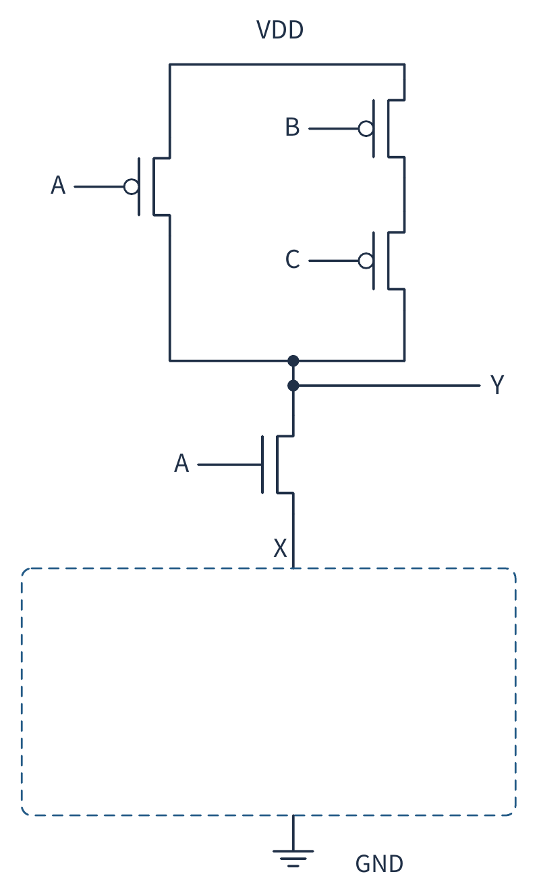
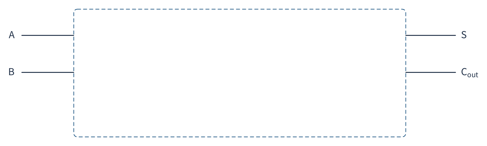
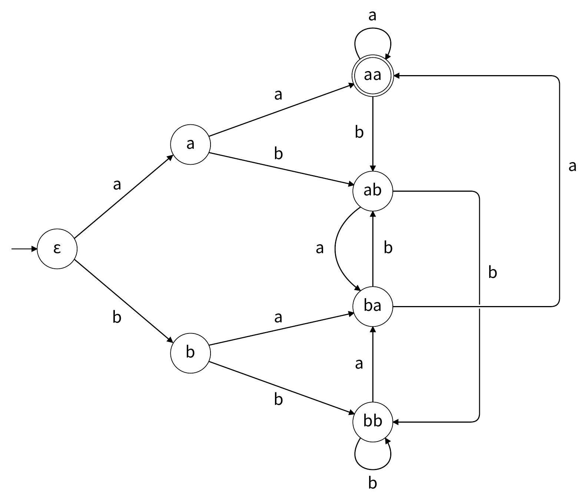
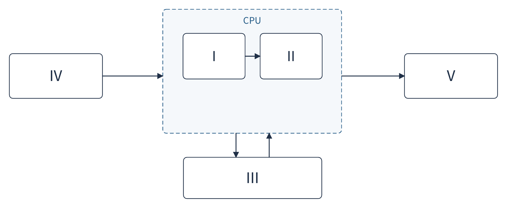
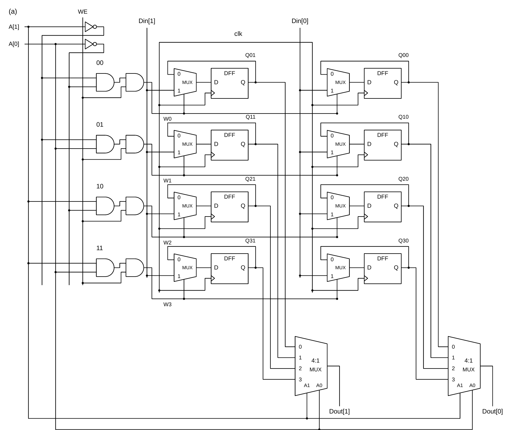
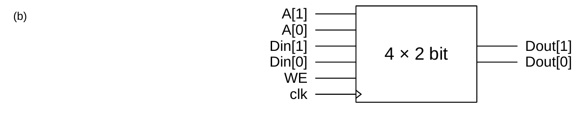

# Introduction to Computer Systems — Homework 2

> Converted from `HW2.pdf`. Figures are rendered from the original PDF and saved in `img/`.

---

## 1 Static CMOS Circuits

Figure 1 shows an incomplete static CMOS circuit. All inputs and outputs take logic values 0 or 1. VDD denotes logic 1, and GND denotes logic 0.

<em>Figure 1: An incomplete static CMOS circuit.</em>

1. Without changing the existing circuit, add two NMOS transistors inside the dashed box, with gates controlled by B and C, respectively, so that the result is a static CMOS circuit.
2. Write the Boolean expression for output Y of the completed circuit in Figure 1.

---

## 2 Functional Completeness and a One-Bit Half Adder

Two sets of logic gates are available:

- **Set I**: two-input exclusive-OR (XOR) gates and NOT gates.
- **Set II**: two-input NOR gates.

Any finite number of the gates in either set may be used. The same signal may be connected to both inputs of a gate.

1. Determine whether Set I and Set II are functionally complete. For the functionally complete set, draw implementations of the three basic operations NOT, AND, and OR using only gates from that set.
2. Using the functionally complete set, design the one-bit half adder shown in Figure 2. Its inputs are addend bits $A$ and $B$; its outputs are sum bit $S$ and carry output $C_{out}$. They satisfy the integer relation

$$A + B = 2C_{out} + S.$$

   Derive Boolean expressions for $S$ and $C_{out}$, and draw the complete logic-gate circuit.

<em>Figure 2: One-bit half-adder interface.</em>

> **Note:** Every gate in the final circuit must belong to the set you selected. The final circuit may not use external constant inputs. Minimizing the number of gates is not required.

---

## 3 Analyze and Redesign a Finite-State Machine

Figure 3 shows a deterministic finite automaton. Its input alphabet is $\{a, b\}$. For each input character, follow the arrow bearing that character. The seven states are named $\varepsilon$, a, b, aa, ab, ba, and bb. The arrow with no source points to the initial state, and a double circle indicates an accepting state.

After the entire input has been read, the automaton accepts the string if it is in an accepting state and rejects it otherwise. Apply the same rule to the empty string.

<em>Figure 3: Seven-state deterministic finite automaton.</em>

1. For each of the strings `a`, `aab` and `bbaa`, write the complete sequence of states visited, including the initial state $\varepsilon$, and state whether the string is accepted.
2. In one precise sentence, describe all strings that this automaton accepts.
3. Design a new deterministic finite automaton with fewer states that recognizes the same language. Draw the complete state-transition diagram, marking the initial state, the accepting state, and the transition on each of a and b from every state.

> **Hint:** This automaton tracks a suffix pattern of the input string.

---

## 4 Computer Organization and Memory Architecture

1. What are the five basic components commonly included in the von Neumann architecture? In Figure 4, boxes I–V represent these five components. Fill in the name of each box.

<em>Figure 4: The five components of a von Neumann architecture.</em>

2. Look up the definition of the Harvard architecture. Compare it with the von Neumann architecture, and briefly explain how modern computers use these two architectures in practice. Keep your answer to this part within 200 Chinese characters or 200 English words.

   > **Hint:** You do not need to force an entire computer into one completely pure architectural category.

---

## 5 Following the LC-3 Instruction Cycle

Refer to the LC-3 datapath in Figure C.3 of the textbook and the description of the instruction cycle in Chapter 4.

1. Match each register in the first column with its purpose in the second column. Write the corresponding letter next to each number.

   | | Register | | Purpose |
   |---|---|---|---|
   | 1. | PC | A. | Holds the current instruction. |
   | 2. | MAR | B. | Holds data transferred to or from memory. |
   | 3. | MDR | C. | Holds the address used for a memory access. |
   | 4. | IR | D. | Holds the address of the next instruction. |

2. List the six phases of the instruction cycle in order and briefly state the purpose of each phase.

3. Two instruction behaviors are described below. Based on these descriptions, analyze what each instruction does in each of the six phases of its instruction cycle. For each phase, state what work it performs or identify it as omitted if it is unnecessary. Treat the six phases as conceptual semantic phases, not as clock cycles or microarchitectural states.

   Assume that an address mentioned below is computed by adding a base-register value to a sign-extended offset encoded in the instruction.

   - **(a) Instruction A:** Read two source registers, add their values, and write the sum to a destination register. This instruction performs no data-memory access.
   - **(b) Instruction B:** Compute an effective address, read the word stored at that address, add it to the value of a source register, and write the sum back to the same memory address. This is a hypothetical instruction that is not in the LC-3 ISA. Analyze it only at the abstract six-phase semantic level.

4. Evaluate the statement: *"The instruction cycle has six phases, so every instruction takes exactly six clock cycles."* State whether it is correct and explain why.

---

## 6 Reading, Writing, and Expanding a Small Memory

Figure 5(a) shows a 4-word × 2-bit memory with ports A[1:0], Din[1:0], Dout[1:0], WE, and clk. Figure 5(b) is the module's black-box representation.

Use the following read and write rules:

- **Synchronous write:** Only at a rising edge of clk, if WE = 1, Din is written to the word selected by the current value of A. If WE = 0, every word retains its previous value.
- **Asynchronous read:** Regardless of WE, Dout always presents the contents of the word selected by the current value of A after the combinational logic has settled. It is not necessary to wait for a clock edge.

<em>Figure 5: Internal circuit and black-box representation of a four-word, two-bit memory module.</em>

1. Inspect the internal circuit and explain how WE and the decoded address signals determine which flip-flops are updated. Also explain why an unselected word retains its previous value.

2. The initial memory contents and the three consecutive clock-cycle operations are shown below.

   | Address A[1:0] | Initial contents (bit 1, bit 0) |
   |:-:|:-:|
   | 00 | 01 |
   | 01 | 10 |
   | 10 | 11 |
   | 11 | 00 |

   | Cycle | WE | A[1:0] | Din[1:0] |
   |:-:|:-:|:-:|:-:|
   | 1 | 0 | 10 | 00 |
   | 2 | 1 | 01 | 11 |
   | 3 | 0 | 01 | 00 |

   For each cycle, explain the operation (which word is accessed, whether a write occurs, the value written if any, and the value read), and complete the table below. "Before edge" means that the inputs for the cycle are stable but the rising edge has not yet occurred. "After edge" means that the circuit has settled after the rising edge.

   | Cycle | Operation | Dout before edge | Dout after edge | M[00] after | M[01] after | M[10] after | M[11] after |
   |:-:|---|:-:|:-:|:-:|:-:|:-:|:-:|
   | 1 | | | | | | | |
   | 2 | | | | | | | |
   | 3 | | | | | | | |

3. Use four copies of the original module shown in Figure 5(b), together with any needed combinational logic such as NOT gates, AND gates, and multiplexers, to expand the memory to a module with a 3-bit address and a 4-bit word: 8 words × 4 bits = 32 bits.

   Draw the complete connection diagram. Label the external ports A[2:0], Din[3:0], Dout[3:0], WE, and clk, and show the connections to every port of each of the four original modules.
