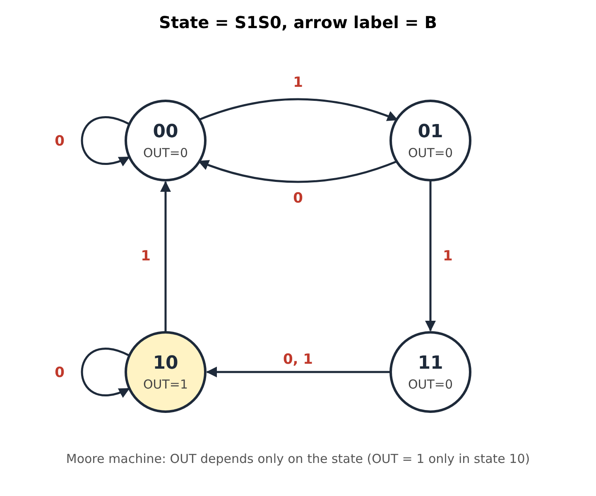

# HW3 Solutions

## T1

$\textbf{sol:}$

(1)

| S1 | S0 | B | S1⁺ | S0⁺ | OUT |
|:-:|:-:|:-:|:-:|:-:|:-:|
| 0 | 0 | 0 | 0 | 0 | 0 |
| 0 | 0 | 1 | 0 | 1 | 0 |
| 0 | 1 | 0 | 0 | 0 | 0 |
| 0 | 1 | 1 | 1 | 1 | 0 |
| 1 | 0 | 0 | 1 | 0 | 1 |
| 1 | 0 | 1 | 0 | 0 | 1 |
| 1 | 1 | 0 | 1 | 0 | 0 |
| 1 | 1 | 1 | 1 | 0 | 0 |

(2) Each state is labeled S1S0 together with its output; each arrow is labeled with the input B.

| Current state | OUT | B = 0 → | B = 1 → |
|:-:|:-:|:-:|:-:|
| 00 | 0 | 00 | 01 |
| 01 | 0 | 00 | 11 |
| 11 | 0 | 10 | 10 |
| 10 | 1 | 10 | 00 |

---

## T2

$\textbf{sol:}$

Decoding the program:

| Address | Instruction | Meaning |
|:-:|:-:|---|
| x3000 | `AND R0, R0, #0` | R0 ← 0 |
| x3001 | `ADD R0, R0, #2` | R0 ← R0 + 2, sets CC |
| x3002 | `BRzp X` | if Z or P, PC ← x3003 + SEXT(X) |
| x3003 | `ADD R0, R0, #3` | R0 ← R0 + 3 |
| x3004 | `ADD R0, R0, #1` | R0 ← R0 + 1 |
| x3005 | `TRAP x25` | HALT |

After x3001, R0 = 2 > 0, so P = 1 and the branch is taken. The target is x3003 + SEXT(X).

| X | Does the program halt? | Value stored in R0 |
|:-:|:-:|:-:|
| `000000010` | Yes | 2 (target x3005: x3003 and x3004 are skipped, so R0 is still 2 when the program halts) |
| `000000001` | Yes | 3 (target x3004: 2 + 1) |
| `000000000` | Yes | 6 (target x3003: 2 + 3 + 1) |
| `111111111` | No | – (target x3002: the BR branches to itself forever; CC stays P) |
| `111111110` | Yes | x8004 = −32764 |

Explanation for X = `111111110` (−2): the target is x3001, so x3001 and x3002 form a loop and R0 = 2, 4, 6, …, x7FFE. The next ADD gives R0 = x7FFE + 2 = x8000 (overflow; negative), so N = 1 and BRzp is not taken. Then x3003 gives x8003 and x3004 gives **x8004**, and the program halts.

---

## T3

$\textbf{sol:}$

Memory access = 100 cycles; every other required phase = 1 cycle; a phase that is not required = 0.

| Instruction | FETCH | DECODE | EVAL. ADDR. | FETCH OPERANDS | EXECUTE | STORE RESULT | Total |
|---|:-:|:-:|:-:|:-:|:-:|:-:|:-:|
| `LDI R3, LABEL` | 100 | 1 | 1 | 200 | 0 | 1 | **303** |
| `STR R1, R2, #5` | 100 | 1 | 1 | 1 | 0 | 100 | **203** |
| `NOT R4, R5` | 100 | 1 | 0 | 1 | 1 | 1 | **104** |
| `JMP R7` | 100 | 1 | 0 | 1 | 0 | 1 | **103** |

- LDI: EVALUATE ADDRESS computes PC + SEXT(PCoffset9); FETCH OPERANDS needs **two** memory reads (first read the pointer stored at LABEL, then read the data at that address) = 200; STORE RESULT writes R3.
- STR: EVALUATE ADDRESS computes R2 + 5; FETCH OPERANDS reads R1; STORE RESULT writes memory = 100.
- NOT: no address; reads R5, ALU computes NOT, writes R4.
- JMP: no address; reads R7, then writes it into the PC.

---

## T4

$\textbf{sol:}$

With 32 registers, every register field needs $\lceil \log_2 32 \rceil = 5$ bits instead of 3.

1. **Yes.** ADD/AND in immediate mode: 4 (opcode) + 5 (DR) + 5 (SR1) + 1 (mode bit) = 15 bits, so the immediate field shrinks from 5 bits to **1 bit**, and its range shrinks from −16 ~ 15 to −1 ~ 0. Register mode is even worse: 4 + 5 + 5 + 1 + 5 = 20 bits > 16, so it no longer fits. NOT still fits (4 + 5 + 5 = 14 bits).
2. **Yes.** LD/ST: 4 (opcode) + 5 (DR/SR) = 9 bits, so PCoffset9 becomes PCoffset**7**. The reachable range shrinks from PC+1 + [−256, 255] to PC+1 + [**−64, 63**].
3. **No.** BR has no register field: it is 4 (opcode) + 3 (n, z, p) + 9 (PCoffset9) = 16 bits, so its format and range are unchanged.

---

## T5

$\textbf{sol:}$

(a) $\lceil \log_2 100 \rceil = 7$ bits (since $2^6 = 64 < 100 \le 128 = 2^7$).

(b) $\lceil \log_2 64 \rceil = 6$ bits.

(c) $32 - 7 - 3 \times 6 = 7$ bits.

---

## T6

$\textbf{sol:}$

All 12 cells start at 1 (every word = 111).

| Cycle | A[1:0] | WE | Din | Effect |
|:-:|:-:|:-:|:-:|---|
| 1 | 01 | 1 | 101 | M[01] ← 101 |
| 2 | 11 | 0 | 110 | read M[11], no write |
| 3 | 10 | 1 | 010 | M[10] ← 010 |
| 4 | 01 | 1 | 011 | M[01] ← 011 |
| 5 | 11 | 0 | 101 | read M[11], no write |
| 6 | 00 | 1 | 111 | M[00] ← 111 |
| 7 | 11 | 1 | 111 | M[11] ← 111 |
| 8 | 11 | 0 | 010 | read M[11] = 111, no write |

Just before the end of cycle 8 (rows in the figure from top to bottom are addresses 00, 01, 10, 11; columns are bit 2, bit 1, bit 0):

| Address | bit 2 | bit 1 | bit 0 |
|:-:|:-:|:-:|:-:|
| 00 | 1 | 1 | 1 |
| 01 | 0 | 1 | 1 |
| 10 | 0 | 1 | 0 |
| 11 | 1 | 1 | 1 |

Dout[2] = 1, Dout[1] = 1, Dout[0] = 1 (the word at address 11).

---

## T7

$\textbf{sol:}$

| Operation No. | R/W | MAR | MDR |
|:-:|:-:|:-:|:-:|
| 1 | W | x4000 | 11110 |
| 2 | R | x4003 | 10110 |
| 3 | W | x4001 | 10110 |
| 4 | R | x4002 | 01101 |
| 5 | W | x4003 | 01101 |

| Location | Before Access 1 | After Access 3 | After Access 5 |
|:-:|:-:|:-:|:-:|
| x4000 | 01101 | 11110 | 11110 |
| x4001 | 11010 | 10110 | 10110 |
| x4002 | 01101 | 01101 | 01101 |
| x4003 | 10110 | 10110 | 01101 |
| x4004 | 11110 | 11110 | 11110 |

Reasoning:
- x4000 changes from 01101 to ____0 by access 3, so access 1 writes 11110 to x4000.
- x4001 changes from 11010 to _0__0, so access 3 (the write of 10___) goes to x4001.
- Because the MDR can only get a value from memory by a read, the 10___ in access 3 must come from a read in access 2. The only location holding 10___ is x4003 = 10110, so access 2 reads x4003 and access 3 writes 10110 to x4001.
- x4003 becomes 01101 by access 5, so access 5 writes 01101 to x4003. That MDR value must come from a read in access 4. The only location that can hold 01101 is x4002 (_1___), so access 4 reads x4002 = 01101.

---

## T8

$\textbf{sol:}$

Idea: $R3 = A \oplus B = \overline{\overline{A\bar B} \cdot \overline{\bar A B}}$, with A = R1 and B = R2.

| Address | Instruction | Assembly | Meaning |
|:-:|:-:|---|---|
| x3000 | `1001 111 001 111111` | `NOT R7, R1` | R7 = NOT A |
| x3001 | `1001 110 010 111111` | `NOT R6, R2` | R6 = NOT B |
| x3002 | `0101 101 111 000 010` | `AND R5, R7, R2` | R5 = (NOT A) AND B |
| x3003 | `0101 110 001 000 110` | `AND R6, R1, R6` | R6 = A AND (NOT B) |
| x3004 | `1001 001 101 111111` | `NOT R1, R5` | R1 = NOT((NOT A) AND B) |
| x3005 | `1001 110 110 111111` | `NOT R6, R6` | R6 = NOT(A AND (NOT B)) |
| x3006 | `0101 000 001 000 110` | `AND R0, R1, R6` | R0 = R1 AND R6 |
| x3007 | `1001 011 000 111111` | `NOT R3, R0` | R3 = A XOR B |

(x3003 must use R1 before x3004 overwrites it.)

---

## T9

$\textbf{sol:}$

Only **instruction 2** can be used as a NOP.

1. `0001 000 000 1 00000` = `ADD R0, R0, #0`: R0 is unchanged, but the **condition codes are set** according to R0, so a later BR may behave differently. Not a NOP.
2. `0000 111 000000000` = `BRnzp #0`: always branches to PC + 0, which is just the next instruction; no register or condition code changes. **Works as a NOP.**
3. `0000 101 000000100` = `BRnp #4`: if N or P is set, it **jumps to PC + 4, skipping the next 4 instructions**; it only falls through when Z is set. Not a NOP.
4. `1001 010 111 111111` = `NOT R2, R7`: **overwrites R2** with NOT R7 and **sets the condition codes**. Not a NOP.
5. `1111 0000 00100011` = `TRAP x23` (IN): prints a prompt, **waits for a key**, puts the character in **R0**, and the TRAP also overwrites **R7** with the return address (and sets the condition codes). Not a NOP.

---

## T10

$\textbf{sol:}$

**Limitations of BR:** its target is PC-relative: target = PC + 1 + SEXT(PCoffset9). The 9-bit offset only reaches −256 ~ +255 words from the next instruction, so BR cannot jump to an address far away. Also, the offset is fixed when the program is assembled, so BR cannot jump to an address that is computed while the program runs.

**How JMP solves it:** `JMP BaseR` sets PC ← BaseR. Because the register holds a full 16-bit address, JMP can reach **any** location in the 64K address space, and the target can be **computed at run time** (e.g., `RET` = `JMP R7` returns to the address saved by a subroutine call). JMP is unconditional; to jump far conditionally, combine a BR with a JMP.
