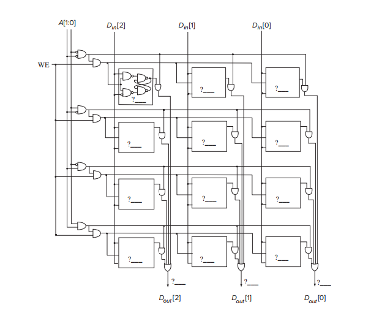

# Introduction to Computer Systems — Homework 3

## T1

A finite state machine is built from two D flip-flops storing state bits S1 and S0, one input B, and one output OUT. The combinational logic is:

$$S1^{+} = (S1 \text{ AND } (\text{NOT } B)) \text{ OR } (S0 \text{ AND } B)$$

$$S0^{+} = (\text{NOT } S1) \text{ AND } B$$

$$OUT = S1 \text{ AND } (\text{NOT } S0)$$

(1) Construct the truth table for the combinational logic.

| S1 | S0 | B | S1⁺ | S0⁺ | OUT |
|:-:|:-:|:-:|:-:|:-:|:-:|
| 0 | 0 | 0 | | | |
| 0 | 0 | 1 | | | |
| 0 | 1 | 0 | | | |
| 0 | 1 | 1 | | | |
| 1 | 0 | 0 | | | |
| 1 | 0 | 1 | | | |
| 1 | 1 | 0 | | | |
| 1 | 1 | 1 | | | |

(2) Draw the state machine.

---

## T2

An LC-3 program is stored in memory locations x3000 to x3005. Note that the branch instruction in memory location x3002 has an unspecified PCoffset9, denoted as X.

| Address | Instruction |
|:-:|:-:|
| x3000 | `0101 000 000 1 00000` |
| x3001 | `0001 000 000 1 00010` |
| x3002 | `0000 011 X` |
| x3003 | `0001 000 000 1 00011` |
| x3004 | `0001 000 000 1 00001` |
| x3005 | `1111 0000 0010 0101` |

The program starts executing with PC = x3000.

Your job: In the table below, for each value of X, answer the question: "Does the program halt?" (Yes or No). If your answer is "Yes", answer the question: "What value is stored in R0 immediately after the instruction at x3004 completes execution?" If your answer is "No", put a dash in the column labeled "Value stored in R0".

| X | Does the program halt? | Value stored in R0 |
|:-:|:-:|:-:|
| `000000010` | | |
| `000000001` | | |
| `000000000` | | |
| `111111111` | | |
| `111111110` | | |

---

## T3

Say it takes 100 cycles to read from or write to memory and only one cycle to read from or write to a register. Assume each phase (if required) takes one cycle, unless a memory access is required.

Calculate the number of cycles it takes for each phase of the instruction cycle (FETCH, DECODE, EVALUATE ADDRESS, FETCH OPERANDS, EXECUTE, STORE RESULT) and the total number of cycles for the following LC-3 instructions:

1. `LDI R3, LABEL`
2. `STR R1, R2, #5`
3. `NOT R4, R5`
4. `JMP R7`

---

## T4

Suppose we changed the LC-3 to have 32 registers instead of 8, while keeping every instruction 16 bits wide and keeping the basic format of all instructions otherwise unchanged. For each of the following, answer yes or no, and explain your answer.

1. Would there be any cost for the operate instructions (ADD 0001, AND 0101, NOT 1001)? Specifically, what happens to the immediate field of ADD/AND?
2. Would there be any cost for the load (LD 0010) and store (ST 0011) instructions? Specifically, what happens to PCoffset9 and the range of addresses reachable?
3. Is the conditional branch instruction (BR 0000) affected at all? Why or why not?

---

## T5

Suppose a 32-bit instruction takes the following format:

| OPCODE | DR | SR1 | SR2 | UNUSED |
|:-:|:-:|:-:|:-:|:-:|

If there are 100 opcodes and 64 registers,

(a) What is the minimum number of bits required to represent the OPCODE?

(b) What is the minimum number of bits required to represent each register field?

(c) What is the maximum number of UNUSED bits in the instruction encoding?

---

## T6

The $2^2$ by 3 bit memory discussed in class is accessed during five consecutive clock cycles. The table below shows the values of the two-bit address, one-bit write enable, and three-bit data-in signals during each access.

| Cycle | A[1:0] | WE | Din[2:0] |
|:-:|:-:|:-:|:-:|
| 1 | 01 | 1 | 101 |
| 2 | 11 | 0 | 110 |
| 3 | 10 | 1 | 010 |
| 4 | 01 | 1 | 011 |
| 5 | 11 | 0 | 101 |
| 6 | 00 | 1 | 111 |
| 7 | 11 | 1 | 111 |
| 8 | 11 | 0 | 010 |

Your job: Fill in the value stored in each memory cell and the three data-out lines just before the end of the eighth cycle. Assume initially that all 12 memory cells store the value 1. In the figure below, each question mark (?) indicates a value that you need to fill in.

---

## T7

Consider a memory that we will perform five successive accesses to. The following table shows the type of each access (Read (load), Write (store)), and the contents of the MAR and MDR at the completion of the access. Note that we have shortened the addressability to 5 bits.

| Operation No. | R/W | MAR | MDR |
|:-:|:-:|:-:|:-:|
| 1 | W | x\_\_\_\_ | 11110 |
| 2 | \_ | x\_\_\_\_ | \_\_\_\_ |
| 3 | W | x\_\_\_\_ | 10\_\_\_ |
| 4 | \_ | x\_\_\_\_ | \_\_\_\_ |
| 5 | \_ | x\_\_\_\_ | \_\_\_\_ |

The following table shows the contents of memory locations x4000 to x4004 before the first access, after the third access, and after the fifth access.

| Location | Before Access 1 | After Access 3 | After Access 5 |
|:-:|:-:|:-:|:-:|
| x4000 | 01101 | \_\_\_\_0 | \_\_\_\_\_ |
| x4001 | 11010 | \_0\_\_0 | \_\_\_\_\_ |
| x4002 | \_1\_\_\_ | \_\_\_\_\_ | \_\_\_\_\_ |
| x4003 | 10110 | \_\_\_\_\_ | 01101 |
| x4004 | 11110 | 11110 | 11110 |

We have added a constraint to this problem in order to get one correct answer: The MDR can ONLY be loaded from memory as a result of a load (read) access.

You're required to fill in the blanks.

---

## T8

The LC-3 does not have an opcode for the logical function XOR. The eight-instruction sequence below performs the XOR of the contents of R1 and R2 and puts the result in R3. Fill in the four missing instructions so that the sequence will do the job.

| Address | Instruction |
|:-:|:-:|
| x3000 | |
| x3001 | `1001 110 010 111111` |
| x3002 | `0101 101 111 000 010` |
| x3003 | |
| x3004 | `1001 001 101 111111` |
| x3005 | |
| x3006 | |
| x3007 | `1001 011 000 111111` |

---

## T9

We would like to have an instruction that does nothing. Many ISAs actually have an opcode devoted to doing nothing, usually called NOP (NO OPERATION). The instruction is fetched, decoded, and executed; the execution phase does nothing.

Which of the following five instructions could be used as a NOP and have the program still work correctly in all cases? For the others, describe precisely what side effect each one has.

1. `0001 000 000 1 00000`
2. `0000 111 000000000`
3. `0000 101 000000100`
4. `1001 010 111 111111`
5. `1111 0000 00100011`

---

## T10

Please describe the limitations of the BR instruction in LC-3 and how JMP instruction addresses the issue.
